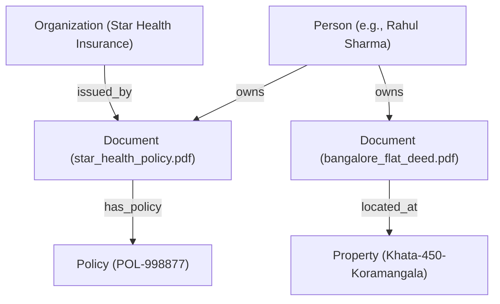

# Knowledge Graph & Proactive Intelligence — Personal Document Finder

## Overview

The **Knowledge Graph** in Personal Document Finder provides an in-process, semantic relationship network connecting entities extracted from personal documents. By modeling documents not merely as unstructured text blocks, but as structured relationships among real-world entities (Persons, Organizations, Policies, Properties, Bank Accounts, Tax IDs), the platform enables multi-hop reasoning, cross-document aggregation, and proactive alerts.

---

## 1. Graph Architecture & Data Model

The graph engine is built using **NetworkX** (`nx.MultiDiGraph`), partitioned in-memory on a per-user basis to guarantee strict multi-tenant isolation.

### Node Types (`NodeType`)
- `Document`: Represents the physical/scanned document record (`id`, `filename`, `category`, `page_count`).
- `Person`: Individuals (policyholders, purchasers, tenants, employees).
- `Policy`: Insurance, warranty, and loan policy identifiers.
- `BankAccount`: Bank accounts, IFSC codes, and credit line numbers.
- `Property`: Real estate addresses, survey numbers, and Khata numbers.
- `TaxIdentifier`: PAN, Aadhaar, Passport, and Driving License numbers.
- `Organization`: Issuers, insurers, employers, banks, and government bodies.
- `DateEvent`: Key dates (issue dates, maturity dates, expiration dates).

### Relationship Types (`RelationType`)
- `owns`: `(Person) -> (Document)`
- `has_policy`: `(Document) -> (Policy)`
- `has_account`: `(Document) -> (BankAccount)`
- `contains`: `(Document) -> (TaxIdentifier)`
- `issued_by`: `(Organization) -> (Document)`
- `located_at`: `(Document) -> (Property)`
- `associated_with`: Generic bidirectional entity association.

---

## 2. Ingestion & Graph Construction

When a document is indexed:
1. `KnowledgeGraphManager.get_or_build_graph(db, user_id)` extracts all classified entities for the user's `READY` documents from SQLAlchemy.
2. Nodes and edges are created dynamically with normalized entity keys (e.g. `policy_POL-998877`, `person_rahul sharma`).
3. Multi-document connections emerge automatically (e.g., a single `Person` node connects to their health insurance, car registration, and house deed).

---

## 3. Querying the Graph

The REST endpoint `GET /api/v1/graph` supports:
- **Full Portfolio Graph**: Retrieve the entire multi-relational graph for the user.
- **Entity Filter**: Query specific node classes (e.g. `entity_type=Policy`).
- **Keyword & Label Subgraph**: Match entity strings (e.g. `query=Rahul`).
- **Document 1-Hop Subgraph**: Retrieve the immediate neighborhood of a specific document (`document_id=1`).

---

## 4. Proactive Intelligence & Alerts

`AlertService` leverages both extracted entities and graph connectivity to generate proactive alerts:

| Alert Dimension | Trigger Condition | Severity |
| :--- | :--- | :--- |
| **Expiry Alerts** | Expiry date is past or within `warning_days` (default 60 days) | `critical` / `warning` |
| **Missing Insurance** | Property records exist without home insurance policy | `warning` |
| **Missing Tax ID** | Banking/Tax records exist without indexed PAN / ID | `info` |
| **Missing Auto Policy** | Driving License found without vehicle insurance policy | `info` |
| **Exact Duplicates** | Identical SHA-256 file hashes across uploads | `warning` |
| **Near-Duplicates** | Cosine embedding similarity $\ge 0.88$ | `info` |
| **Version Revisions** | Document version count $> 1$ | `info` |
